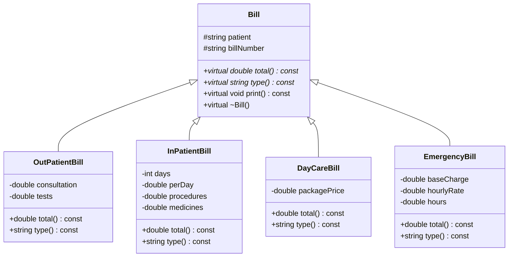

# Task A1 – Design the Polymorphic Bill Hierarchy

## A1.1 Common interface
Every bill needs `total() const` to calculate the amount, `type() const` to identify the bill, and `print() const` to display its details. Common data: patient identifier/name, bill number, and billing date. Derived classes keep their own charge details.

## A1.2 Hierarchy and UML
`Bill` is abstract because `total()` and `type()` are pure virtual. `print()` is a normal public member that uses the virtual functions.


`*` means pure virtual. `total()` and `type()` are virtual in the base and overridden in each concrete class. The base destructor is virtual.

## A1.3 Pseudocode: process a day's bills
```text
ALGORITHM CalculateDailyTotal
INPUT: bills[0..n-1], an array of pointers to Bill
OUTPUT: dailyTotal

BEGIN
    dailyTotal ← 0
    FOR i ← 0 TO n-1
        IF bills[i] IS NOT NULL THEN
            dailyTotal ← dailyTotal + bills[i].total()
        END IF
    END FOR
    DISPLAY dailyTotal
END
```

## Alternative: tagged structure and switch
A single structure stores a `BillType` tag and fields for every bill kind. `total()` switches on the tag and applies the matching formula. Both designs take O(n) time to total n bills. The tagged structure may reserve space for the largest set of fields in every record; a polymorphic object stores its own fields plus implementation overhead (commonly a vptr). Adding a bill type requires editing the switch and the central structure; with polymorphism, a new derived class can implement the interface without editing the processing loop. The switch can be faster in some workloads, so measurements matter.
